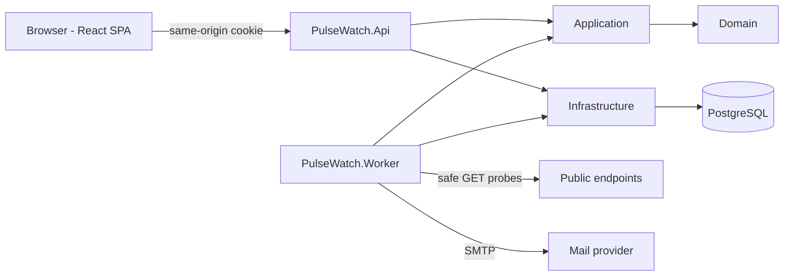

# PulseWatch — Full Implementation Plan

> Source: *PulseWatch_Master_Prompt_and_Implementation_Plan.docx* (9 Oct 2026).
> This plan merges the document's Part I and its two master prompts into a single build contract.
> Where they conflict, §1 records which decision was taken and why.

**Product:** a self-hostable tool that checks HTTP APIs on a schedule, records health and latency, opens and recovers incidents, sends email alerts without duplicates, and shows history in a React dashboard.

**Environment found on this machine (8 Nov 2026):** .NET SDK 10.0.400 ✔ · Node 24.13 / npm 11.6 ✔ · Docker 29.5 ✔ · Git 2.51 ✔ · `psql` not installed (not needed — use Docker). The project folder is empty.

---

## Contents

1. [Decisions that resolve conflicts in the document](#1-decisions-that-resolve-conflicts-in-the-document)
2. [Architecture](#2-architecture)
3. [Data model](#3-data-model)
4. [Core logic: probes, scheduler, incidents, notifications](#4-core-logic)
5. [SSRF protection design](#5-ssrf-protection-design)
6. [API contract](#6-api-contract)
7. [Frontend plan](#7-frontend-plan)
8. [Configuration](#8-configuration)
9. [Milestones (build order, tasks, exit gates)](#9-milestones)
10. [Test matrix](#10-test-matrix)
11. [CI, Docker and deployment](#11-ci-docker-and-deployment)
12. [Risks, limitations and later work](#12-risks-limitations-and-later-work)
13. [How to drive the AI agent](#13-how-to-drive-the-ai-agent)

---

## 1. Decisions that resolve conflicts in the document

The document contains a short prompt (milestones M0–M7) and a longer prompt (M0–M8). They disagree on these points:

| Topic | Option A in the doc | Option B in the doc | **Decision** | Why |
|---|---|---|---|---|
| Auth | Identity + cookie | JWT + refresh tokens allowed | **Identity + HttpOnly cookie, same origin** | No tokens in the browser, no refresh-token storage to build. SPA served from the same origin (Vite proxy in dev, API serves `wwwroot` in prod), so CORS isn't needed. |
| Frontend folder | `web/` | `frontend/pulsewatch-web` | **`web/`** | Shorter. Matches the starter commands. |
| Recovery rule | Close on first success | Consecutive-success threshold | **`RecoveryThreshold`, default 1** | Covers both. Defaults to the simple behaviour. |
| Expected status | Not configurable | Configurable range | **`ExpectedStatusMin`/`Max`, default 200–299** | Small cost, real value (e.g. a 401 health endpoint). |
| Timeout unit | Seconds | Milliseconds | **`TimeoutMs` (1 000–15 000, default 10 000)** | Finer control, same validation. |
| Monitor states | Healthy / Failing / Paused / Unknown | Unknown / Healthy / Degraded / Down / Paused | **Unknown, Healthy, Degraded, Down, Paused** | Degraded = failing but below threshold. Down = incident open. More informative. |
| Notification durability | Delivery table; outbox is "hardening" | Transactional outbox required | **Outbox from the start (M5)** | It's ~1 table + 1 loop. The incident change and the outbox row are written in **one transaction**, which closes the "commit vs send" gap the doc warns about. |
| Multiple workers | Single worker, leases later | Claims/leases required | **Lease-based claiming (`FOR UPDATE SKIP LOCKED`) built in M3; run 1 replica until the concurrency test passes** | The SQL is short. Building it now avoids redoing the scheduler later. |
| Edit endpoint | `PATCH` | `PUT` | **`PATCH`** with an allow-list of fields | Partial updates; avoids mass assignment. |
| Pause / resume | Through PATCH | `/pause` and `/resume` | **Dedicated `/pause` and `/resume` endpoints** | Clear UI actions, simple tests. |
| Manual check | In MVP | "Later", return 202 | **In MVP: `POST /check-now` → 202**, sets `NextCheckAtUtc = now`, limited to 1/min per monitor | It goes through the same worker path and SSRF checks, so it adds no new outbound route. |
| Incidents listing | Per monitor | Global | **Both** | Detail page needs per-monitor; dashboard needs global. |
| Delete policy | Undecided | — | **Hard delete, cascades to checks, incidents and outbox rows** | Simplest to reason about and test. Documented in README. |
| Milestone order | Notifications + UI together | Separate | **The longer prompt's 9 milestones (M0–M8)**, with URL validation pulled into M2 | Smaller review steps. |
| API style | Controllers or minimal APIs | — | **Minimal APIs with route groups per feature** | Less ceremony. .NET 10 has built-in minimal-API validation. |

---

## 2. Architecture

### 2.1 Shape

Modular monolith: **two executables** (API, Worker) that share three class libraries, one PostgreSQL database and a React SPA.



The API never makes outbound probes. Only the Worker does. This keeps the risky network path in one process that can be firewalled.

### 2.2 Projects and references

| Project | Contains | References |
|---|---|---|
| `src/PulseWatch.Domain` | Entities, enums, `IncidentStateMachine`, `CheckClassifier`, value objects (`MonitorUrl`, `StatusRange`) | none |
| `src/PulseWatch.Application` | Use cases (`CreateMonitor`, `RecordCheckResult`, …), DTOs, validators, interfaces (`IProbeRunner`, `IDestinationPolicy`, `IDnsResolver`, `IEmailSender`, `IAppDbContext`), options classes | Domain |
| `src/PulseWatch.Infrastructure` | `PulseWatchDbContext` + configurations + migrations, `HttpProbeRunner`, `SafeConnectHandler`, `PublicDestinationPolicy`, `SystemDnsResolver`, `SmtpEmailSender`, `LoggingEmailSender`, monitor-claim SQL | Application, Domain |
| `src/PulseWatch.Api` | Endpoint groups, Identity, antiforgery, rate limiting, Problem Details, OpenAPI, health checks, serves the built SPA | Application, Infrastructure |
| `src/PulseWatch.Worker` | `SchedulerService`, `OutboxDispatcherService`, `RetentionService`, `HeartbeatService` | Application, Infrastructure |
| `tests/PulseWatch.UnitTests` | Domain and application rules, SSRF policy, classifiers | Domain, Application, Infrastructure (policy/handler only) |
| `tests/PulseWatch.IntegrationTests` | API + real Postgres (Testcontainers), worker loops with fake probe/email | Api, Worker, Infrastructure |
| `web/` | React + TS + Vite SPA | HTTP API only |

`Directory.Build.props` sets for all projects: `net10.0`, `Nullable=enable`, `ImplicitUsings=enable`, `TreatWarningsAsErrors=true`, `AnalysisLevel=latest`. A `global.json` pins the SDK to `10.0.400` with `rollForward: latestPatch`.

### 2.3 Key libraries (check latest stable for net10.0 when adding)

| Need | Package |
|---|---|
| EF Core + Postgres | `Microsoft.EntityFrameworkCore` 10.x, `Npgsql.EntityFrameworkCore.PostgreSQL` 10.x (same major), `Microsoft.EntityFrameworkCore.Design` (tools) |
| Identity | `Microsoft.AspNetCore.Identity.EntityFrameworkCore` |
| OpenAPI | `Microsoft.AspNetCore.OpenApi` (built in) + `Scalar.AspNetCore` for a dev UI |
| Health | `AspNetCore.HealthChecks.NpgSql` or a small custom `DbContext` check |
| Email | `MailKit` |
| Time | `TimeProvider` (built in); `Microsoft.Extensions.TimeProvider.Testing` in tests |
| Tests | `xunit` (v3), `Microsoft.AspNetCore.Mvc.Testing`, `Testcontainers.PostgreSql`, `Shouldly` or `FluentAssertions` (check the license) |
| Frontend | `react`, `react-router`, `@tanstack/react-query`, `tailwindcss` v4, `recharts`, `react-hook-form` + `zod`, `vitest`, `@testing-library/react`, `msw` |

No Redis, no message broker, no Kubernetes, no MediatR.

---

## 3. Data model

All IDs are `uuid` (generated with `Guid.CreateVersion7()` so they sort by time). All timestamps are `timestamptz`, stored in UTC. snake_case table names via the Npgsql naming convention.

### 3.1 Tables

**`AspNetUsers`** (Identity) — adds `CreatedAtUtc`.

**`monitors`**

| Column | Type | Rule |
|---|---|---|
| id | uuid PK | |
| owner_user_id | text FK → users, `ON DELETE CASCADE` | indexed |
| name | varchar(100) | required, trimmed |
| url | varchar(2048) | http/https only, no user-info |
| is_enabled | bool | |
| interval_seconds | int | CHECK 60 ≤ x ≤ 3600 |
| timeout_ms | int | CHECK 1000 ≤ x ≤ 15000, and `timeout_ms < interval_seconds*1000` |
| failure_threshold | int | CHECK 1–10, default 3 |
| recovery_threshold | int | CHECK 1–10, default 1 |
| expected_status_min / max | int | CHECK 100 ≤ min ≤ max ≤ 599, default 200/299 |
| state | smallint enum | Unknown, Healthy, Degraded, Down, Paused |
| consecutive_failures / consecutive_successes | int | ≥ 0 |
| last_checked_at_utc | timestamptz null | |
| last_outcome / last_status_code / last_duration_ms | null | denormalised for list views |
| next_check_at_utc | timestamptz | |
| lease_until_utc | timestamptz null | set while a worker owns the check |
| manual_check_requested_at_utc | timestamptz null | for the 1/min rate limit |
| created_at_utc / updated_at_utc | timestamptz | |
| xmin | concurrency token | optimistic concurrency on edits |

Indexes: `(owner_user_id)`, partial `(next_check_at_utc) WHERE is_enabled`.

**`monitor_checks`** (append-only)

| Column | Type |
|---|---|
| id | uuid PK |
| monitor_id | uuid FK `ON DELETE CASCADE` |
| started_at_utc, completed_at_utc | timestamptz |
| duration_ms | int |
| outcome | smallint enum: Success, HttpStatusFailure, Timeout, DnsFailure, TlsFailure, ConnectionFailure, RedirectRejected, DestinationBlocked, ResponseTooLarge, UnexpectedError |
| http_status_code | int null |
| error_summary | varchar(200) null — fixed safe text chosen by code, never an exception message |

Index: `(monitor_id, started_at_utc DESC)`.

**`incidents`**

| Column | Type |
|---|---|
| id | uuid PK |
| monitor_id | uuid FK `ON DELETE CASCADE` |
| status | smallint: Open, Resolved |
| first_failure_at_utc | timestamptz (first failure in the streak) |
| opened_at_utc | timestamptz (threshold confirmed) |
| resolved_at_utc | timestamptz null |
| failure_count | int (failures while open, including the opening streak) |
| last_failure_at_utc | timestamptz null |
| opening_outcome / opening_status_code | evidence for the email and UI |

Indexes: **partial unique `(monitor_id) WHERE status = 0`** (only one open incident per monitor, enforced by the database), and `(monitor_id, opened_at_utc DESC)`.

**`notification_outbox`**

| Column | Type |
|---|---|
| id | uuid PK |
| incident_id | uuid FK `ON DELETE CASCADE` |
| event_type | smallint: IncidentOpened, IncidentResolved |
| channel | smallint: Email |
| recipient | varchar(256) |
| idempotency_key | varchar(200) **UNIQUE** — `"{incidentId}:{eventType}:{channel}:{recipient}"` |
| status | smallint: Pending, Sending, Sent, Failed (will retry), Exhausted |
| attempt_count | int |
| next_attempt_at_utc | timestamptz |
| lease_until_utc | timestamptz null |
| last_attempt_at_utc, sent_at_utc | null |
| last_error_category | varchar(100) null |
| created_at_utc | timestamptz |

Index: partial `(next_attempt_at_utc) WHERE status IN (Pending, Failed)`.

**`worker_heartbeats`** — `worker_id`, `last_seen_at_utc`, `version`. Lets the UI tell "your API is down" apart from "PulseWatch's worker is down".

### 3.2 Data rules
- Pages are bounded: `pageSize` 1–100 (default 25). Checks also require a time window of at most 30 days (the retention period).
- Retention: checks older than `CheckRetentionDays` (30) are deleted in batches. Incidents and outbox rows are not deleted by retention.
- Monitor quota per user: 20 (configurable), checked in a transaction on create.

---

## 4. Core logic

### 4.1 Probe (`HttpProbeRunner`)
1. The named `HttpClient` "probe" is built with `IHttpClientFactory` on top of `SafeConnectHandler` (see §5): `AllowAutoRedirect=false`, `UseCookies=false`, `AutomaticDecompression=None`, `PooledConnectionLifetime=2min`, no proxy.
2. Request: `GET`, headers `User-Agent: PulseWatch/<version> (+repo url)` and `Accept: */*`. No body, no user-supplied headers.
3. Timeout: a linked `CancellationTokenSource` with `TimeoutMs`, covering connect + headers + body read.
4. Send with `HttpCompletionOption.ResponseHeadersRead`. Read and discard at most `MaxResponseBytes` (64 KB). If more arrives, stop reading (outcome stays based on status; optionally `ResponseTooLarge` if the body exceeds a hard cap — decide in M3 and test it).
5. Redirects (3xx with `Location`): follow at most 3. Resolve the new URL against the old one, re-run **full** URL validation, then connect through the same safe handler. Loop or limit exceeded → `RedirectRejected`.
6. Classify **exactly once per attempt**. Never retry the target request.

| Evidence | Outcome |
|---|---|
| Final status within expected range | Success |
| Status outside range | HttpStatusFailure (status stored) |
| Our timeout token fired | Timeout |
| `SocketException` HostNotFound / `DestinationBlockedException` from DNS step | DnsFailure / DestinationBlocked |
| `AuthenticationException` inside `HttpRequestException` | TlsFailure |
| `HttpRequestError.ConnectionError` / refused / reset | ConnectionFailure |
| Anything else | UnexpectedError (exception type logged, message not stored) |

Duration is measured with `TimeProvider.GetTimestamp()` from send start to body done.

### 4.2 Scheduler (`SchedulerService : BackgroundService`)

Every `PollIntervalSeconds` (5 s):

```sql
-- claim a batch atomically; safe with several workers
UPDATE monitors m
SET lease_until_utc = now() + make_interval(secs => @leaseSeconds)
WHERE m.id IN (
  SELECT id FROM monitors
  WHERE is_enabled
    AND next_check_at_utc <= now()
    AND (lease_until_utc IS NULL OR lease_until_utc < now())
  ORDER BY next_check_at_utc
  LIMIT @batchSize
  FOR UPDATE SKIP LOCKED)
RETURNING m.id, m.url, m.timeout_ms, ...;
```

- `leaseSeconds` = max timeout + 30 s margin.
- Run the claimed monitors through a `Parallel.ForEachAsync` with `MaxDegreeOfParallelism = MaxConcurrentChecks` (10). A global `SemaphoreSlim` caps outbound concurrency.
- Each monitor is wrapped in its own `try/catch`. One failure is logged and the loop carries on.
- After the probe: `RecordCheckResult` use case (§4.3) runs in **one transaction**: insert the check, update counters and state, open/resolve the incident, insert outbox rows, set `next_check_at_utc = started_at + interval` (if that is already past, `now + interval` to avoid catch-up bursts), clear the lease.
- If the monitor was paused, edited or deleted while being probed: reload inside the transaction. Deleted → drop the result. Paused → save the check but don't change incidents. Edited → use the new interval.
- Restart safety: leases expire by themselves, so nothing gets stuck. A crash mid-probe means that check simply isn't recorded, and the monitor runs again after the lease expires.
- Shutdown: stop claiming, let in-flight probes finish or cancel when the host shutdown timeout (30 s) runs out.
- Scheduling tolerance (documented): a check runs within `PollIntervalSeconds + queue delay` of its due time. The `worker.lag_seconds` metric measures this.

### 4.3 Incident state machine (pure domain code, fully unit-tested)

Input: monitor counters + current open incident (if any) + new check result + time.

```
Success:
  consecutive_successes++ ; consecutive_failures = 0
  if open incident and consecutive_successes >= recovery_threshold:
      resolve incident (resolved_at = check time) -> emit IncidentResolved
  state = open incident ? Down : Healthy

Failure:
  consecutive_failures++ ; consecutive_successes = 0
  if open incident: failure_count++, last_failure_at = now      (no new event)
  elif consecutive_failures >= failure_threshold:
      open incident (first_failure_at = time of failure #1 of the streak,
                     opened_at = now) -> emit IncidentOpened
  state = open incident ? Down : Degraded

Paused monitor: state = Paused. Result saved, no transitions.
Monitor with no checks yet: state = Unknown.
```

To know `first_failure_at` without scanning history, keep `streak_started_at_utc` on the monitor (set on the first failure of a streak).

Idempotency: the partial unique index stops a second open incident even if the same result were processed twice. Catch the unique-violation, reload, and continue.

Pausing does not close an open incident. It stays open, shown as "Paused (incident open)". Resuming continues the streak. This is documented.

### 4.4 Notifications (outbox)
- `RecordCheckResult` adds one outbox row per recipient (MVP: the owner's email) in the same transaction as the incident change. A duplicate key → ignored (`ON CONFLICT DO NOTHING`).
- `OutboxDispatcherService` every 10 s: claim up to 20 rows that are `Pending`/`Failed` and due, using the same `SKIP LOCKED` + lease pattern, then send through `IEmailSender`.
  - Success → `Sent`, `sent_at_utc`.
  - Transient failure → `Failed`, `attempt_count++`, `next_attempt = now + min(30s × 2^attempt, 1h)` with jitter.
  - After `MaxAttempts` (6) or a permanent error (bad address) → `Exhausted`. Shown in the UI on the incident.
- Email content: plain text + simple HTML, built from stored data only (monitor name, host + path **without the query string**, outcome, status, times in UTC, link to the incident). Monitor names are HTML-encoded and CR/LF is stripped from anything used in headers.
- Residual gap (documented): if SMTP accepts the mail but the worker dies before marking `Sent`, that email goes out twice. This is "at-least-once" delivery — state it plainly.
- Dev: `LoggingEmailSender` writes to the log. Docker Compose also includes **Mailpit** (local SMTP + web inbox) for realistic end-to-end tests.

### 4.5 Metrics and uptime
- **Sampled uptime** = successful checks ÷ completed checks in the window (24 h / 7 d / 30 d). No checks → "No data", never 100 %. Sample count always shown next to it.
- **p95 latency** = PostgreSQL `percentile_cont(0.95) WITHIN GROUP (ORDER BY duration_ms)` over **successful** checks in the window. The method is described in the UI tooltip.
- **Stale**: enabled monitor with `last_checked_at_utc < now − (2 × interval + 60 s)`. Shown with a badge and counted in the summary.
- **Worker offline**: newest heartbeat older than 60 s → banner across the dashboard.

---

## 5. SSRF protection design

This is a release blocker. Defence in depth, in four layers:

**Layer 1 — URL validation (create, update, and every redirect)** — `MonitorUrlValidator`
- `Uri.TryCreate(..., Absolute)`; scheme `http` or `https` only.
- No user-info (`user:pass@`), length ≤ 2048, no fragment.
- Port in the allowed list (default `80, 443, 8080, 8443`; configurable).
- Hostname: rejects `localhost`, `*.localhost`, `*.local`, `*.internal`, `*.home.arpa`, `metadata.google.internal`, and hosts without a dot. Also rejects odd IP spellings (`0x7f.1`, `2130706433`, `127.1`) by parsing literal IPs strictly and rejecting anything `IPAddress.TryParse` accepts but that isn't in normal dotted/colon form.
- IP literal → Layer 2 check right away.

**Layer 2 — IP policy** — `PublicDestinationPolicy.IsAllowed(IPAddress)`
- Unwrap IPv4-mapped IPv6 (`::ffff:a.b.c.d`) with `MapToIPv4()` before checking. Also treat NAT64 `64:ff9b::/96`, 6to4 `2002::/16` and Teredo `2001::/32` as blocked (they can wrap internal IPv4).
- Blocked IPv4: `0.0.0.0/8, 10/8, 100.64/10, 127/8, 169.254/16 (includes 169.254.169.254 metadata), 172.16/12, 192.0.0/24, 192.0.2/24, 192.88.99/24, 192.168/16, 198.18/15, 198.51.100/24, 203.0.113/24, 224/4, 240/4, 255.255.255.255`.
- Blocked IPv6: `::/128, ::1/128, fc00::/7, fe80::/10, ff00::/8, 2001:db8::/32, 100::/64, fec0::/10`, plus the wrapping ranges above.
- Implemented with `System.Net.IPNetwork.Contains` (built in since .NET 8) — no string matching.

**Layer 3 — Connect-time pinning (blocks DNS rebinding)** — `SafeConnectHandler`
- `SocketsHttpHandler.ConnectCallback` resolves the host with `IDnsResolver`, checks **every** A/AAAA answer, and rejects the request if **any** answer is blocked. It then opens the socket to one of the vetted addresses.
- Because the request URI still carries the hostname, TLS SNI and certificate validation run against the real name. Hostname checking stays on.
- The address checked is the address connected to, so DNS can't change between check and use.
- `UseProxy = false` so no environment proxy can bypass this.

**Layer 4 — Network egress control (deployment)**
- The Worker runs in its own Docker network. Host firewall rules (`DOCKER-USER` chain) drop worker egress to RFC 1918, link-local, loopback and the metadata IP, and allow only Postgres + SMTP + public internet. Documented in `docs/deployment.md` with the exact rules and a test command.

**Limits:** per-user quota, minimum interval 60 s, timeout ≤ 15 s, 64 KB body cap, 3 redirects, global concurrency 10, `check-now` 1/min per monitor and 10/min per user, create/update 30/min per user.

**Testing without weakening production:**
- Unit tests feed a fake `IDnsResolver` (e.g. `evil.test → [93.184.216.34, 10.0.0.1]`) into the real policy and handler.
- Integration tests that need a local target replace `IDestinationPolicy` through DI **inside the test project only**. There is no config flag that allows loopback, so Production can't turn it on.
- `docs/threat-model.md` lists what's covered and what's left (e.g. a public IP that forwards to internal services is out of scope; Layer 4 reduces it).

---

## 6. API contract

Base `/api/v1`. JSON camelCase. Times are ISO-8601 UTC (`Z`). Errors use RFC 9457 Problem Details. Validation errors list fields. Missing **or not owned** → `404` (same response, so IDs can't be probed).

### Auth
| Method & route | Notes |
|---|---|
| `GET /auth/antiforgery` | Sets the `XSRF-TOKEN` cookie (readable by JS). SPA sends it back as `X-XSRF-TOKEN` on every write. |
| `POST /auth/register` | email + password (Identity rules: ≥ 12 chars). Rate limited 5/min per IP. Always same response shape so emails can't be enumerated. |
| `POST /auth/login` | Sets the `pw.auth` cookie: HttpOnly, Secure, SameSite=Strict, 7-day sliding. Lockout after 5 failures. Rate limited 10/min per IP. |
| `POST /auth/logout` | Clears cookie. |
| `GET /auth/me` | `{ id, email }` or 401. |

Cookie auth on `/api` returns **401/403**, not a redirect to a login page (override `OnRedirectToLogin`).

### Monitors
| Method & route | Behaviour |
|---|---|
| `GET /monitors?page=&pageSize=&state=` | Owner's monitors, with latest result + stale flag. |
| `POST /monitors` | Validate (§5 Layer 1 + DNS pre-check), quota, `201` + `Location`. `next_check_at = now`. |
| `GET /monitors/{id}` | Detail + 24 h / 7 d / 30 d sampled uptime, p95, sample counts. |
| `PATCH /monitors/{id}` | Allowed fields: name, url, intervalSeconds, timeoutMs, failureThreshold, recoveryThreshold, expectedStatusMin/Max. `If-Match` with the `xmin` version → `412` on conflict. Changing the URL resets counters and state to Unknown. |
| `POST /monitors/{id}/pause` · `/resume` | Idempotent. Resume sets `next_check_at = now`. |
| `POST /monitors/{id}/check-now` | `202`. `429` with `Retry-After` if used within 60 s. |
| `DELETE /monitors/{id}` | `204`. Cascades. |
| `GET /monitors/{id}/checks?fromUtc=&toUtc=&page=&pageSize=` | Newest first. Window ≤ 30 days. |
| `GET /monitors/{id}/checks/series?window=24h\|7d\|30d` | Downsampled points for the chart (avg/max per bucket, ≤ 300 points). |
| `GET /monitors/{id}/incidents?page=&pageSize=` | Newest first. |

### Incidents & dashboard
| Method & route | Behaviour |
|---|---|
| `GET /incidents?status=open\|resolved&page=&pageSize=` | All of the user's incidents. |
| `GET /incidents/{id}` | Incident + its notification deliveries (status, attempts, last error category). |
| `GET /dashboard/summary` | Counts by state, stale count, open incidents, worker last seen. |

### Health (no auth, not under `/api`)
| Route | Behaviour |
|---|---|
| `GET /health/live` | Process is up. No dependencies. |
| `GET /health/ready` | Database reachable + migrations applied. Returns only `Healthy/Unhealthy`, no details. |

OpenAPI at `/openapi/v1.json` with a Scalar UI, **development only**.

---

## 7. Frontend plan

**Stack:** React + strict TypeScript + Vite, React Router, TanStack Query, Tailwind v4, Recharts, react-hook-form + zod, Vitest + Testing Library + MSW.

**Structure (by feature):**
```
web/src/
  api/          client.ts (fetch wrapper: credentials, XSRF header, Problem Details → typed error), types.ts
  features/
    auth/       LoginPage, RegisterPage, useMe, RequireAuth
    dashboard/  DashboardPage, SummaryCards, WorkerBanner
    monitors/   MonitorListPage, MonitorDetailPage, MonitorForm, LatencyChart, ChecksTable, StatusBadge
    incidents/  IncidentListPage, IncidentDetailPage, IncidentTimeline
  components/   Button, Dialog (confirm), Toast, EmptyState, ErrorState, Skeleton, Pagination
  lib/          time.ts (UTC → local with tz label), format.ts
```

**Routes:** `/login`, `/register`, `/` (dashboard), `/monitors`, `/monitors/new`, `/monitors/:id`, `/monitors/:id/edit`, `/incidents`, `/incidents/:id`. All except auth routes sit behind `RequireAuth`.

**UX rules from the document:**
- Every status badge has **text + icon + colour** (not colour alone). AA contrast. Visible focus rings. Fully keyboard usable. Proper labels on every input.
- Each data view has loading (skeleton), empty, error (with retry) and stale states.
- Uptime always shows the window and sample count, and "No data" when there are none. A tooltip explains "sampled uptime".
- Times shown in local time with the timezone label; hover shows UTC.
- Delete opens a confirm dialog naming the monitor.
- Detail page refetches every 30 s; a "last updated" note shows when data is old or a fetch failed (cached data is never shown as current).
- Form validation in zod mirrors the server rules, but server errors from Problem Details are mapped onto the fields — the server is the authority.
- No buttons that do nothing.

**Dev setup:** Vite proxies `/api` and `/health` to the API, so the browser sees one origin and the cookie is first-party. Production: `npm run build` output is copied into the API's `wwwroot` and served with SPA fallback.

---

## 8. Configuration

Typed options classes validated on startup (`ValidateDataAnnotations().ValidateOnStart()`), so bad config fails fast with a clear message.

| Key | Default | Used by |
|---|---|---|
| `ConnectionStrings__PulseWatch` | — (user-secrets / env) | both |
| `Monitoring__PollIntervalSeconds` | 5 | Worker |
| `Monitoring__BatchSize` | 50 | Worker |
| `Monitoring__MaxConcurrentChecks` | 10 | Worker |
| `Monitoring__DefaultIntervalSeconds` / `Minimum…` / `Maximum…` | 60 / 60 / 3600 | both |
| `Monitoring__MaxTimeoutMs` | 15000 | both |
| `Monitoring__MaxResponseBytes` | 65536 | Worker |
| `Monitoring__MaxRedirects` | 3 | Worker |
| `Monitoring__AllowedPorts` | 80,443,8080,8443 | both |
| `Monitoring__MaxMonitorsPerUser` | 20 | API |
| `Monitoring__CheckRetentionDays` | 30 | Worker |
| `Notifications__MaxAttempts` | 6 | Worker |
| `Notifications__Provider` | `Logging` \| `Smtp` | Worker |
| `Email__Host`, `__Port`, `__Username`, `__Password`, `__FromAddress`, `__UseStartTls` | — | Worker |
| `App__PublicBaseUrl` | `http://localhost:5173` | Worker (links in emails) |

Dev secrets: `dotnet user-secrets` per host project. Docker: `.env` (git-ignored) with `.env.example` holding placeholders only.

---

## 9. Milestones

Each milestone = one feature branch → PR → merge to `main`, with CI green and a short entry in `docs/progress.md`. Time estimates are rough, for one developer working part-time (~15 h/week).

### M0 — Repository and scaffold (≈ 3–4 days)
**Tasks**
- `git init`, `.gitignore` (dotnet + node + `.env`), `.editorconfig`, `.gitattributes`, `global.json`, `Directory.Build.props`, `Directory.Packages.props` (central package versions).
- `dotnet new sln` (→ `PulseWatch.slnx`), the 5 src + 2 test projects, references exactly as in §2.2.
- `docker-compose.yml`: `postgres:17` (or latest stable) with named volume, health check, port bound to `127.0.0.1` only; `mailpit` for dev mail.
- `.env.example` with placeholders.
- API: `/health/live` and a stub `/health/ready` (real DB check comes in M1); Worker: empty `BackgroundService` that logs a heartbeat.
- `web/`: Vite react-ts, strict TS, ESLint, Prettier, Tailwind, a shell layout with nav, Vitest with one real render test.
- `.github/workflows/ci.yml` (see §11).
- README v0 (what it is, prerequisites, how to run), LICENSE (MIT), `docs/progress.md`.

**Exit gate:** clean clone → `docker compose up -d db` healthy → `dotnet build` and `dotnet test` pass → `npm ci && npm run lint && npm run build && npm test` pass → CI green on GitHub. No secrets in repo.

### M1 — Domain and persistence (≈ 1 week)
**Tasks**
- Domain: `Monitor`, `MonitorCheck`, `Incident`, `NotificationOutboxMessage`, enums, `StatusRange`, `MonitorUrl` (syntax checks only), `IncidentStateMachine`, `MonitorState` rules.
- Unit tests for the state machine boundaries (threshold 1, 3, 10; recovery 1 and 2; streak reset; paused).
- `PulseWatchDbContext` (+ Identity tables), entity configurations, CHECK constraints, partial unique index, all indexes, snake_case naming, `xmin` concurrency token.
- Initial migration. `dotnet ef` instructions in README. **No auto-migrate in Production**; dev-only `--migrate` switch on the API.
- Real `/health/ready` (DB + pending migrations).
- Integration test fixture: Testcontainers Postgres, apply migrations, Respawn-style reset between tests.
- Integration tests: migration applies on empty DB; second open incident for same monitor fails; FK cascades work; CHECK constraints reject bad values.

**Exit gate:** fresh DB migrates; domain + constraint tests pass.

### M2 — Auth and secure monitor CRUD (≈ 1.5 weeks)
**Tasks**
- Identity (`AddIdentityCore` + cookie), password rules, lockout, the auth endpoints, antiforgery with header token, 401 instead of redirect.
- Global exception handler → Problem Details (no stack traces outside Development).
- Rate limiter policies (per-IP for auth, per-user for writes and check-now).
- `MonitorUrlValidator` (Layer 1) + `PublicDestinationPolicy` (Layer 2) + DNS pre-check on create/update via `IDnsResolver`.
- Monitor endpoints: list, create, get, patch, pause, resume, delete, check-now (only sets fields; worker comes in M3). Quota. Optimistic concurrency.
- Every query goes through `db.Monitors.Where(m => m.OwnerUserId == currentUser)` — put this in one helper so nobody forgets it.
- OpenAPI + Scalar in dev, with the cookie auth scheme described.
- Integration tests: unauthenticated → 401; user B on user A's ID → 404 for **every** route; invalid inputs → 400 with field errors; quota → 409/422; missing XSRF header → 400; rate limits → 429; delete cascades.
- Unit tests: URL validator and IP policy table (all ranges in §5, IPv4-mapped IPv6, odd IP spellings, bad schemes `file:`, `ftp:`, `gopher:`, `javascript:`, user-info, ports).

**Exit gate:** cross-user isolation tests pass for all routes; unsafe URLs rejected; OpenAPI correct.

### M3 — Probe engine and scheduler (≈ 1.5 weeks)
**Tasks**
- `SafeConnectHandler` (Layer 3), `HttpProbeRunner` with timeout, body cap, manual redirects with revalidation, classification table (§4.1).
- Named `HttpClient` registration; no Polly retry on this client (on purpose — comment says why).
- Claim SQL + `SchedulerService` with bounded parallelism, per-monitor `try/catch`, lease release, graceful shutdown.
- `RecordCheckResult` saving the check and updating counters/state/next-check (incident logic is called but stays minimal until M4, or fold M4 in if it's going smoothly).
- `HeartbeatService`.
- Unit tests with a fake `HttpMessageHandler` and fake DNS: each outcome; timeout fires; cancellation; redirect to blocked IP → `RedirectRejected`; redirect loop; mixed public/private DNS → blocked; rebinding (resolver returns public then private — connection must use the vetted address or be refused); oversized body stops reading.
- Integration tests: due monitor gets exactly one check; paused monitor gets none; a throwing probe doesn't stop other monitors; **two scheduler instances against one DB never probe the same monitor at the same time** (the concurrency test that unlocks multi-replica); lease expiry recovers after a simulated crash.

**Exit gate:** all outcomes covered by deterministic tests; worker survives failing targets; claim test passes.

### M4 — Incident state machine end-to-end (≈ 1 week)
**Tasks**
- Wire `IncidentStateMachine` into `RecordCheckResult` in one transaction, with unique-violation handling.
- Monitor state updates (Unknown/Healthy/Degraded/Down/Paused), `streak_started_at_utc`.
- Incident endpoints (per-monitor, global, detail).
- Integration test with a **controllable fake target** (test-only DI): healthy → 3 failures → incident opens once at failure #3 with correct `first_failure_at` → more failures don't open another → success → resolves once → more successes don't resolve again. Repeat with recovery threshold 2. Restart the worker mid-incident → no duplicate.
- Processing the same result twice → no duplicate incident.

**Exit gate:** no duplicate open incidents; thresholds exactly as documented; durations correct.

### M5 — Notifications (≈ 1 week)
**Tasks**
- Outbox rows written inside the incident transaction.
- `OutboxDispatcherService` with lease, backoff + jitter, `Exhausted` state.
- `IEmailSender` with `LoggingEmailSender` (dev default) and `SmtpEmailSender` (MailKit).
- Email templates (text + HTML), header-injection safe, no query strings, no secrets.
- Expose delivery history on `GET /incidents/{id}`.
- Tests: open + resolve each create exactly one outbox row (unique key); sender fails twice then works → Sent with attempt 3; always failing → Exhausted after max attempts; dispatcher restart → no second send of a Sent row; SMTP outage doesn't affect check recording; logs contain no SMTP password (capture logs in test and assert).
- Manual check against Mailpit.

**Exit gate:** transient failures retry; exhausted visible; committed events never silently lost.

### M6 — Frontend product (≈ 2 weeks)
**Tasks**
- API client + types, auth pages, `RequireAuth`, layout/nav, toasts.
- Dashboard (summary cards, open incidents, worker banner).
- Monitor list (cards on mobile, table on desktop), create/edit form, detail page (stat tiles with sample counts, latency chart, checks table with pagination, incidents), pause/resume/check-now/delete with confirm.
- Incident list + detail with timeline and delivery status.
- All loading/empty/error/stale states.
- Tests (Vitest + MSW): login flow; form shows server field errors; list empty state; "No data" uptime instead of 100 %; stale badge; delete confirm; status badge has text.
- Optional: one Playwright smoke test (register → add monitor → see a check) run against Docker Compose.

**Exit gate:** full happy path works in the browser against real API data; frontend tests pass; no fake data.

### M7 — Metrics and operations (≈ 1 week)
**Tasks**
- Uptime/p95/series queries with tests on known data sets (including empty window).
- `System.Diagnostics.Metrics` meter `PulseWatch`: `checks.completed{outcome}`, `check.duration`, `worker.lag_seconds`, `incidents.opened/resolved`, `notifications.sent/failed/exhausted`, `outbox.pending`. Optional OpenTelemetry exporter (off by default).
- Structured JSON logs with scopes (`MonitorId`, `CheckId`, `TraceId`), URL logged as scheme + host only.
- `RetentionService`: daily, deletes old checks in batches of 5 000, never touches incidents; test it.
- Review query plans (`EXPLAIN ANALYZE`) for due-claim, check history and summary with ~1 M seeded checks.
- Small load test: 500 monitors at 60 s on one worker; record lag, CPU, DB size growth in `docs/load-test.md`.
- Dev-only seed command (`dotnet run --project src/PulseWatch.Api -- seed-demo`), refused outside Development.

**Exit gate:** calculations tested; cleanup bounded; readiness correct; worker activity visible in metrics/logs; load-test numbers written down.

### M8 — Hardening and open-source release (≈ 1 week)
**Tasks**
- Full SSRF review against OWASP cheat sheet; write `docs/threat-model.md`.
- Security headers (CSP, `X-Content-Type-Options`, `Referrer-Policy`, HSTS in prod), HTTPS redirection, no dev exception page in prod.
- Production Dockerfiles (multi-stage, non-root, chiseled/alpine runtime), `docker-compose.prod.yml` with Caddy for HTTPS, worker on an isolated network + documented egress firewall rules.
- `docs/deployment.md`: config, migrations (`dotnet ef migrations bundle`), backups (`pg_dump` cron + restore test), logs, single-VM topology, "one worker until…" note.
- README final: problem, features, architecture diagram, screenshots, setup, config table, tests, security notes, limitations, roadmap.
- `SECURITY.md`, `CONTRIBUTING.md`, `CODE_OF_CONDUCT.md`, issue + PR templates, Dependabot config.
- Clean-clone test on a second machine or fresh VM.
- Public demo only with seeded safe targets and strict quotas — never an open URL checker.

**Exit gate:** a newcomer can clone, run and contribute from the README; CI green; no secrets; limitations documented.

**Total:** roughly **11–13 weeks** part-time, or 5–6 weeks full-time.

---

## 10. Test matrix

| Area | Unit | Integration | Milestone |
|---|---|---|---|
| State machine thresholds, reset, recovery, paused | ✔ | ✔ (end-to-end lifecycle) | M1, M4 |
| URL validation, schemes, user-info, ports, odd IP forms | ✔ | ✔ (API returns 400) | M2 |
| IP policy: all blocked v4/v6 ranges, IPv4-mapped, NAT64, 6to4 | ✔ | | M2 |
| Mixed DNS answers, rebinding, redirect to blocked, redirect loop | ✔ (fake DNS/handler) | | M3 |
| Outcome classification, timeout, cancellation, body cap | ✔ | | M3 |
| Auth required, cross-user 404 on every route, XSRF | | ✔ | M2 |
| Quotas and rate limits | | ✔ | M2 |
| Migrations, constraints, partial unique index | | ✔ | M1 |
| One check per attempt, failing target isolation, paused skipped | | ✔ | M3 |
| Two workers, no overlapping claims; lease recovery | | ✔ | M3 |
| Outbox idempotency, retry, exhausted, restart | ✔ | ✔ | M5 |
| No secrets in logs or Problem Details | | ✔ (captured logs) | M5, M8 |
| Uptime/p95 maths incl. empty window | ✔ | ✔ | M7 |
| Retention never deletes incidents | | ✔ | M7 |
| UI states, field errors, "No data", stale | ✔ (Vitest + MSW) | Playwright (optional) | M6 |

Rules: deterministic only (`FakeTimeProvider`, fake DNS, fake handler, fake email). CI never calls public websites or real mailboxes. Every bug fix gets a regression test.

---

## 11. CI, Docker and deployment

**`.github/workflows/ci.yml`**
- `backend` job (ubuntu-latest): `actions/setup-dotnet` with `global.json` → `dotnet restore` → `dotnet format --verify-no-changes` → `dotnet build -c Release --no-restore` → `dotnet test -c Release --no-build --logger trx` (Testcontainers works on GitHub's Ubuntu runners because Docker is present) → upload test results.
- `frontend` job: `actions/setup-node` (LTS, npm cache) → `npm ci` → `npm run lint` → `npm run typecheck` → `npm test -- --run` → `npm run build`.
- Optional `e2e` job later: compose up + Playwright.
- Dependabot for NuGet, npm and Actions. Branch protection on `main` requiring both jobs.

**Dev `docker-compose.yml`:** `db` (Postgres, 127.0.0.1:5432), `mailpit` (SMTP 1025, UI 8025). API/worker/web run from the IDE or `dotnet run` / `npm run dev` for fast reloads. Optional `--profile full` to run everything in containers.

**Deployment (one supported option):** single Linux VM with Docker Compose → Caddy (automatic HTTPS) → API container (serves SPA) → Worker container on an isolated network with egress firewall → Postgres with a volume and nightly `pg_dump`. Migrations run as a separate step with an EF migration bundle before starting the new version.

---

## 12. Risks, limitations and later work

| Risk | Mitigation in this plan |
|---|---|
| SSRF | 4 layers (§5), dedicated tests, egress firewall, threat model, private deployment until reviewed |
| Duplicate checks/alerts | `SKIP LOCKED` leases, partial unique index, outbox unique key, concurrency test |
| Alert storms | Failure threshold, one incident per monitor, one email per event |
| False outage claims | Thresholds, evidence (status/outcome) in UI and email, "checked from one location" note |
| Storage growth | 30-day retention, indexes, bounded queries, downsampled chart endpoint |
| Mail outage | Outbox with retries; incident state independent of email |
| Secrets leak | user-secrets, `.env` ignored, redacted logs, log-capture tests |
| Scope creep | Strict milestone gates; everything below is post-MVP |

**Known limitations to state in the README:** checks come from one location; at-least-once email (rare duplicate possible); one worker replica recommended until you've run the concurrency test in your own deployment; sampled uptime is not true availability; GET only, no custom headers/bodies.

**After MVP (do not build yet):** Slack/Teams/webhooks, maintenance windows, public status pages, response assertions (body contains / JSON path), TLS-certificate expiry warnings, teams/organisations, multi-region probes, SLO tracking, 2FA.

---

## 13. How to drive the AI agent

1. Create the repository folder (this folder works) and start a session there.
2. Paste the **longer master prompt** from the document (section "PULSEWATCH — MASTER IMPLEMENTATION PROMPT"), and add one line: *"Follow IMPLEMENTATION_PLAN.md in the repo root; where it differs from the prompt, the plan wins."*
3. Ask for **one milestone per session**: *"Implement PulseWatch Milestone N from IMPLEMENTATION_PLAN.md only, run the tests, and stop at its exit gate."*
4. Review the diff yourself, run the commands locally, merge, then start the next milestone.
5. Keep `docs/progress.md` updated after each milestone — it doubles as an interview talking point list (what you built, what broke, how you tested it).

**Interview demo script (after M6):** register → add a monitor pointing at a controllable test endpoint → show checks arriving → flip the endpoint to fail → watch Degraded → Down at the threshold → show the email in Mailpit → recover → show the incident timeline and delivery history → show the SSRF tests and the cross-user isolation tests in CI.
