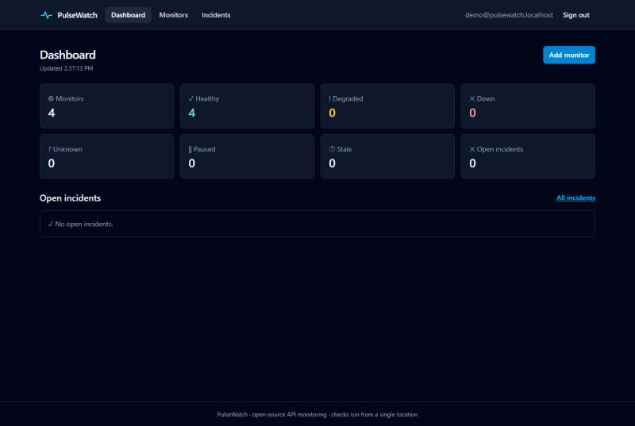
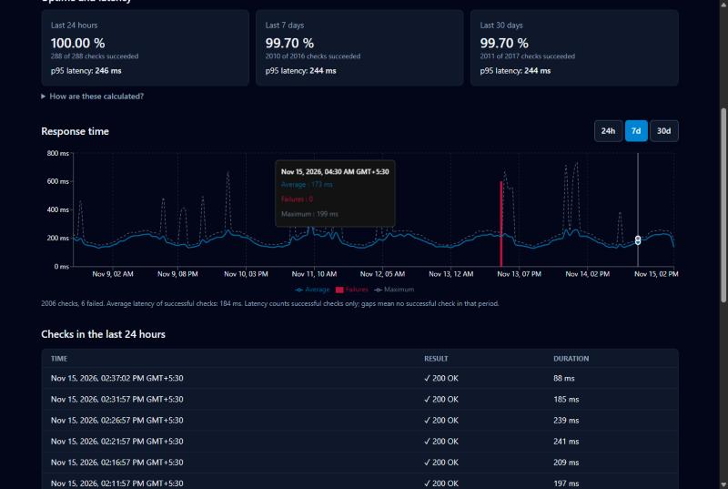
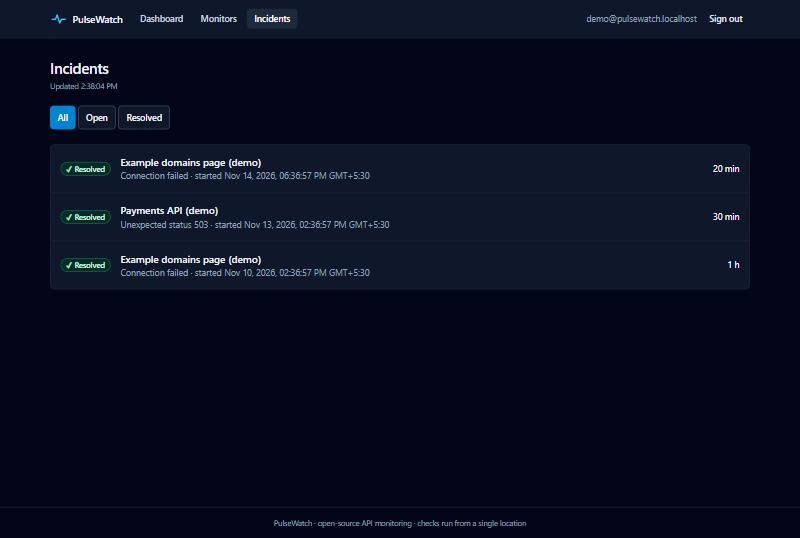
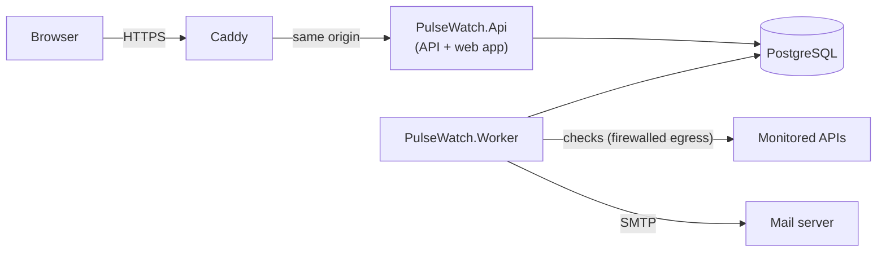
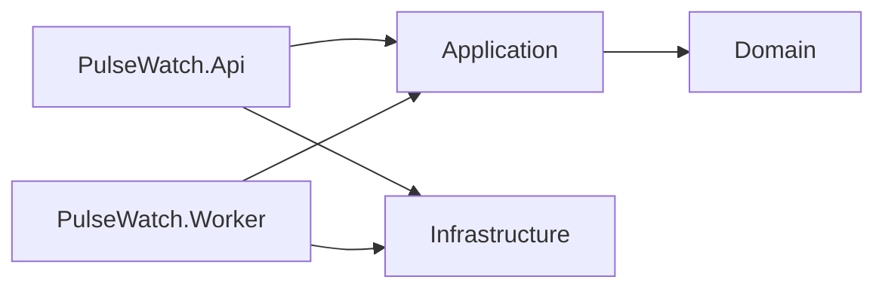

# PulseWatch

**Know when your APIs fail — and understand why.**

PulseWatch is an open-source, self-hostable tool that checks your HTTP APIs on a schedule, records status and response time, opens an incident when failures persist, emails you when it starts and when it recovers, and shows the history in a dashboard.

PulseWatch is built for small teams that want to own their monitoring: one VM, one `docker compose up`, no
third-party service watching your endpoints. It was designed with security first, because a tool that sends
requests to user-chosen URLs is a classic server-side request forgery (SSRF) target.



| Monitor page | Incident timeline |
|---|---|
|  |  |

## Features

- **Scheduled HTTP checks** (every 1–60 min) with timeout, expected status range and redirect rules. One attempt
  per check, so flaky endpoints stay visible.
- **Incidents** that open after N failures in a row and resolve after M successes, so one blip doesn't wake you up.
- **Email alerts** when an incident opens and when it recovers, sent through a transactional outbox with retries,
  so a committed incident never loses its email.
- **Dashboard and history**: state of every monitor, sampled uptime and p95 latency for 24 h / 7 d / 30 d,
  response-time charts, check history, incident timelines with email delivery status.
- **SSRF protection in four layers**: URL rules, public-address policy, connect-time address pinning (blocks DNS
  rebinding) and a worker egress firewall. See the [threat model](docs/threat-model.md).
- **Production deployment**: non-root chiseled images, Caddy with automatic HTTPS, isolated networks,
  migration bundle, backup and restore scripts. See the [deployment guide](docs/deployment.md).
- **Operations**: OpenTelemetry metrics and traces, JSON logs without secrets, automatic cleanup of old checks,
  health endpoints.

**Status:** all planned milestones (M0–M8) are complete; see [docs/progress.md](docs/progress.md) and the
[demo script](docs/demo-script.md). To try it, [run it locally](#getting-started) for development or
[deploy it](#deploying-to-production) on a server.

## Architecture

A modular monolith with two executables sharing class libraries:



Inside, both executables share the same layers:



| Project | Responsibility | May reference |
|---|---|---|
| `src/PulseWatch.Domain` | Entities and business rules | nothing |
| `src/PulseWatch.Application` | Use cases, DTOs, interfaces | Domain |
| `src/PulseWatch.Infrastructure` | EF Core, HTTP probing, email | Application, Domain |
| `src/PulseWatch.Api` | HTTP endpoints, auth, health | Application, Infrastructure |
| `src/PulseWatch.Worker` | Scheduled checks, alerts, retention | Application, Infrastructure |
| `web/` | React + TypeScript + Vite SPA | the HTTP API only |

## Prerequisites

| Tool | Version used | Check |
|---|---|---|
| .NET SDK | 10.0.400 or a later 10.0 feature band (pinned in `global.json`) | `dotnet --list-sdks` |
| Node.js | 22 or later (24 LTS used in development) | `node --version` |
| Docker Desktop | any recent version, running | `docker info` |
| Git | any recent version | `git --version` |

## Getting started

### 1. Start the database and test mail server

```powershell
Copy-Item .env.example .env    # then edit .env and set POSTGRES_PASSWORD
docker compose up -d
docker compose ps              # db and mailpit should show "healthy"
```

macOS/Linux: `cp .env.example .env`.

- PostgreSQL: `localhost:5432` (bound to 127.0.0.1 only)
- Mailpit inbox: <http://localhost:8025>

### 2. Store the connection string and create the schema

Use the same password you put in `.env`:

```powershell
dotnet user-secrets set "ConnectionStrings:PulseWatch" "Host=localhost;Port=5432;Database=pulsewatch;Username=pulsewatch;Password=<your password>" --project src/PulseWatch.Api
dotnet user-secrets set "ConnectionStrings:PulseWatch" "Host=localhost;Port=5432;Database=pulsewatch;Username=pulsewatch;Password=<your password>" --project src/PulseWatch.Worker
dotnet run --project src/PulseWatch.Api -- --migrate
```

`--migrate` applies pending migrations and exits. It only works in Development; see [Database migrations](#database-migrations) for other environments.

### 3. Run the API and worker

In two terminals:

```powershell
dotnet run --project src/PulseWatch.Api       # http://localhost:5080
dotnet run --project src/PulseWatch.Worker
```

Check the API: <http://localhost:5080/health/live> and <http://localhost:5080/health/ready> should both return `Healthy`. Ready returns `Unhealthy` (HTTP 503) if the database is down or migrations are pending.

API reference (Development only): interactive docs at <http://localhost:5080/scalar>, OpenAPI JSON at <http://localhost:5080/openapi/v1.json>.

### 4. Run the frontend

```powershell
cd web
npm install
npm run dev                                    # http://localhost:5173
```

Open <http://localhost:5173>, create an account and add a monitor. With the worker running, the first result appears within a few seconds.

The Vite dev server forwards `/api` and `/health` to the API on port 5080, so the browser sees one origin and the auth cookie stays first-party. Set `PULSEWATCH_API_URL` to point it elsewhere.

Frontend checks (the same ones CI runs):

```powershell
cd web
npm run lint; npm run typecheck; npm test; npm run build
```

## Deploying to production

The supported setup is one Linux VM with Docker Compose. The [deployment guide](docs/deployment.md) covers it
step by step. In short:

```bash
cp .env.prod.example .env && chmod 600 .env    # fill in domain, database password, SMTP
docker compose -f docker-compose.prod.yml build
docker compose -f docker-compose.prod.yml up -d db
docker compose -f docker-compose.prod.yml run --rm migrate
docker compose -f docker-compose.prod.yml up -d
sudo ./deploy/egress-firewall.sh apply           # worker egress firewall (SSRF layer 4)
```

| Piece | What it is |
|---|---|
| `Dockerfile` | Multi-stage build with three targets: `api` (API + web app, ASP.NET chiseled), `worker` (.NET runtime chiseled), `migrations` (EF Core bundle). Non-root, no shell. |
| `docker-compose.prod.yml` | Caddy, API, worker, PostgreSQL. Read-only containers, all capabilities dropped, three networks (`edge`, internal `backend`, `egress` for the worker only). |
| `deploy/Caddyfile` | Automatic HTTPS with Let's Encrypt, HTTP→HTTPS redirect, compression for static files only. |
| `deploy/egress-firewall.sh` | `DOCKER-USER` rules that stop the worker reaching private, local and metadata addresses. |
| `deploy/backup.sh`, `deploy/restore-test.sh` | Nightly `pg_dump` with 14-day retention, and a restore check into a scratch database. |

Registration is closed by default in production: you open it briefly to create your own account.

## Using the web app

- **Dashboard**: counts of monitors by state, stale monitors and open incidents. A banner appears when the PulseWatch worker hasn't reported in for over a minute, so "my API is down" can be told apart from "PulseWatch's checker is down".
- **Monitor page**:
  - **Sampled uptime** is the share of checks that succeeded in the window, with the sample count beside it. A window without checks shows **No data**, never 100 %. Uptime is truncated, not rounded, so a single failure never shows as 100.00 %.
  - **p95** covers successful checks only.
  - The chart shows the average and maximum response time of successful checks, with failures as red bars.
- **Freshness**: pages refresh every 30 seconds and show when they were last updated. If a refresh fails, they say so instead of presenting old data as current.
- **Times** are shown in your time zone with its name; hover a time to see the exact UTC value.
- **Accessibility**: every status badge has text and an icon, not just a colour. Everything works with the keyboard, and the delete dialog names the monitor and starts on Cancel.
- **Privacy**: query strings in monitor URLs are hidden in lists and headers (they often hold API keys). The full URL is only shown in the edit form.

## Using the API

All endpoints are under `/api/v1`. Errors use [Problem Details](https://www.rfc-editor.org/rfc/rfc9457); validation errors list the failing fields.

1. `GET /api/v1/auth/antiforgery` sets an `XSRF-TOKEN` cookie.
2. Send that cookie's value in the `X-XSRF-TOKEN` header on **every** POST, PATCH and DELETE. A fresh token is issued after sign-in and sign-out.
3. `POST /api/v1/auth/register` or `/login` with `{ "email": "...", "password": "..." }` sets the HttpOnly `pw.auth` cookie. Passwords need at least 12 characters. Register answers `403` while registration is closed (`Registration:Enabled=false`).
4. Manage monitors: `GET/POST /api/v1/monitors`, `GET/PATCH/DELETE /api/v1/monitors/{id}`, `POST .../pause`, `.../resume`, `.../check-now`.
5. Read results:
   - `GET /api/v1/monitors/{id}/checks?fromUtc=&toUtc=&page=&pageSize=` — newest first; defaults to the last 24 hours; a window can span at most the retention period (30 days).
   - `GET /api/v1/monitors/{id}/incidents` — this monitor's incidents, newest first.
   - `GET /api/v1/incidents?status=open|resolved` — all your incidents.
   - `GET /api/v1/incidents/{id}` — one incident with its notification history.
   - `GET /api/v1/monitors/{id}/stats` — sampled uptime and p95 latency for 24 h, 7 d and 30 d, with sample counts (`uptimePercent` is `null` when there were no checks).
   - `GET /api/v1/monitors/{id}/checks/series?window=24h|7d|30d` — chart buckets (5 min / 1 h / 4 h) with check and failure counts and the average and maximum latency of successful checks. Empty buckets are included.
   - `GET /api/v1/dashboard/summary` — your monitors by state, stale count, open incidents, and when a worker was last seen.

   Incident durations run from the **first failed check** to recovery (or to now while open). Detection is delayed by the failure threshold: with a 60 s interval and a threshold of 3, an incident opens about 2–3 minutes after the first failure.

Rules worth knowing:
- Another user's monitor or incident id returns the same `404` as an id that doesn't exist.
- Monitor URLs must point to a public destination. Local names (`localhost`, `*.local`, `*.internal`, …), private/reserved IPs and host names whose DNS answers include any non-public address are rejected.
- `PATCH` changes only the fields you send. Send `If-Match: <ETag>` to get `412` instead of overwriting a newer change.
- `check-now` returns `202` and is limited to once per minute per monitor (`429` with `Retry-After`). The worker runs the check on its next poll (within about 5 seconds).

## How checks work

The worker (`src/PulseWatch.Worker`) polls every `Monitoring:PollIntervalSeconds` (5 s):

1. It **leases** up to `BatchSize` (50) enabled monitors that are due, in one SQL statement (`FOR UPDATE SKIP LOCKED`). A leased monitor can't be picked up by another worker until its result is recorded or the lease expires (probe timeout + 30 s), so a crashed worker never leaves a monitor stuck.
2. It **probes** them, at most `MaxConcurrentChecks` (10) at a time. Each probe is one `GET` with the monitor's timeout covering everything, no cookies or credentials, at most `MaxRedirects` (3) redirects (each re-validated), and at most `MaxResponseBytes` (64 KB) of body read.
3. It **records** each result in one transaction: the check row, the monitor's state and counters, an incident if the failure threshold is reached (or its resolution), the alert email for that incident event (an outbox row), and the next check time: one interval after this check was **due**, so the polling delay never adds up (a 60 s monitor is checked every 60 s). If a check ran a whole interval late (for example after the worker was down), that late check counts as the catch-up and the next one is due an interval after it: no burst, no double check.

Outcomes: `Success`, `HttpStatusFailure`, `Timeout`, `DnsFailure`, `TlsFailure`, `ConnectionFailure`, `RedirectRejected`, `DestinationBlocked`, `UnexpectedError`. Stored error summaries are fixed text, never exception messages or response content.

Scheduling tolerance: a check runs within about one poll interval of its due time, plus queueing when more than `MaxConcurrentChecks` monitors are due together. A failed or slow monitor never blocks the others. On shutdown the worker stops claiming and lets in-flight checks finish (up to 30 s).

Results describe what the worker saw from **its** network location, not what every user everywhere sees.

## How email alerts work

The monitor's owner gets **one email when an incident opens** and **one when it recovers**. Nothing is sent for the failures in between.

- **No lost alerts.** The email is queued in the `notification_outbox` table in the same transaction that opens or resolves the incident, so a committed incident always has its email queued. A unique key (incident, event, channel, recipient) prevents duplicates.
- **Delivery.** The worker's outbox dispatcher polls every `Notifications:PollIntervalSeconds` (10 s), leases up to 20 due messages (`FOR UPDATE SKIP LOCKED`) and sends them.
- **Retries.** A failed send is retried after about 30 s, 1, 2, 4 and 8 minutes (doubling, ±20 % jitter, at most 1 hour). After `Notifications:MaxAttempts` (6) attempts, or straight away for a rejected address, the message is marked **Exhausted**.
- **Visible status.** `GET /api/v1/incidents/{id}` lists each email with its status (`Pending`, `Sending`, `Sent`, `Failed`, `Exhausted`), attempt count and an error category such as `ConnectionFailed` or `AuthenticationFailed`. Server replies and exception messages are never stored.
- **Independent of checks.** A mail outage never delays or breaks check recording.
- **Safe content.** Emails show the monitor name, the endpoint **without its query string** (query strings often hold API keys), what failed, UTC times and a link to the incident. Names are HTML-encoded, and line breaks are removed from the subject so they can't add mail headers.

Delivery is **at least once**: if the worker stops after the mail server accepted an email but before it was marked Sent, that email is sent again after the lease expires.

**Providers** (`Notifications:Provider`):

- `Logging` (the default) logs the recipient and subject of each email instead of sending it. The body is not logged, because it contains the endpoint's path; use Mailpit to read full emails.
- `Smtp` sends through the server in the `Email` section. To try it locally with Mailpit:

  ```powershell
  dotnet user-secrets set "Notifications:Provider" "Smtp" --project src/PulseWatch.Worker
  dotnet user-secrets set "Email:Host" "localhost" --project src/PulseWatch.Worker
  dotnet user-secrets set "Email:Port" "1025" --project src/PulseWatch.Worker
  dotnet user-secrets set "Email:UseStartTls" "false" --project src/PulseWatch.Worker
  dotnet user-secrets set "Email:FromAddress" "alerts@pulsewatch.localhost" --project src/PulseWatch.Worker
  ```

  Then open the inbox at <http://localhost:8025>. For a real provider, keep `UseStartTls` at `true` (the default) or use port 465, and put `Email:Username` and `Email:Password` in user-secrets or environment variables. PulseWatch never logs them.

Links in emails point at `App:PublicBaseUrl` (default `http://localhost:5173`).

## Operations

### Demo data

```powershell
dotnet run --project src/PulseWatch.Api -- seed-demo
```

This creates the account `demo@pulsewatch.localhost` with four monitors and a week of history, including a resolved outage with its emails, and prints a one-time password. The history is replayed through the real incident logic, so states, incidents and emails are consistent. The monitors point at the IANA example domains (`example.com` and friends), which exist for this purpose; with the worker running they keep being checked every 5 minutes. Running it again replaces the demo monitors and sets a new password. It only works in Development.

### Metrics

The worker records these on the `PulseWatch` meter (`System.Diagnostics.Metrics`):

| Instrument | Type | Meaning |
|---|---|---|
| `pulsewatch.checks.completed` | counter, tag `outcome` | checks recorded |
| `pulsewatch.check.duration` | histogram, ms, tag `outcome` | probe duration |
| `pulsewatch.worker.lag` | histogram, s | how late a check was claimed after its due time; the key "is the worker keeping up?" signal |
| `pulsewatch.incidents.opened` / `.resolved` | counters | incident changes |
| `pulsewatch.notifications.sent` / `.failed` / `.exhausted` | counters, tag `category` on the last two | email delivery |
| `pulsewatch.outbox.pending` | gauge | emails waiting to be sent or retried |
| `pulsewatch.retention.deleted_checks` | counter | old checks removed |

Nothing is exported by default. To send metrics and traces to an OpenTelemetry Collector (and on to Prometheus, Grafana, etc.), set `Telemetry__OtlpEndpoint`, for example `http://localhost:4317`, on the worker and the API. Without a collector you can watch the meter live with `dotnet-counters monitor -n PulseWatch.Worker --counters PulseWatch`.

### Logs

Outside Development both hosts write **one JSON object per line** to the console, with UTC timestamps and scopes, ready for a log collector. Every line about a check carries `MonitorId`, `CheckId`, `TraceId` and `Target`. `Target` is the URL's **scheme and host only**: paths and query strings often contain tokens and never reach the logs. Email lines carry `MessageId` and `Attempt`. Development keeps the readable text format; switch with `Logging__Console__FormatterName=json` or `simple`.

### Retention

The worker deletes checks older than `Monitoring:CheckRetentionDays` (30) once a day (`Retention:IntervalHours`, 24), starting 2 minutes after it starts. It deletes in batches of `Retention:BatchSize` (5,000) with a short pause between them, so cleanup never blocks checks for long. Incidents and email history are never deleted by retention. The batches use the `ix_monitor_checks_started_at` index (see the [query plan review](docs/query-plans.md)).

## Database migrations

Migrations live in `src/PulseWatch.Infrastructure/Persistence/Migrations`. The EF Core CLI is a local tool:

```powershell
dotnet tool restore
dotnet ef migrations add <Name> --project src/PulseWatch.Infrastructure --startup-project src/PulseWatch.Api --output-dir Persistence/Migrations
dotnet ef migrations script --project src/PulseWatch.Infrastructure --startup-project src/PulseWatch.Api   # review the SQL
```

Applying migrations:

- **Development:** `dotnet run --project src/PulseWatch.Api -- --migrate`
- **Production:** the `migrations` image contains an EF Core migration bundle; run it before starting a new
  version with `docker compose -f docker-compose.prod.yml run --rm migrate` ([deployment guide §5](docs/deployment.md#5-upgrades-and-migrations)).
  The app never migrates automatically on startup.
- **Elsewhere:** build a bundle yourself and run it with the connection string:

  ```powershell
  dotnet ef migrations bundle --project src/PulseWatch.Infrastructure --startup-project src/PulseWatch.Api -o efbundle.exe
  ./efbundle.exe --connection "<connection string>"
  ```

## Running checks

Backend (from the repository root):

```powershell
dotnet format PulseWatch.slnx --verify-no-changes
dotnet build PulseWatch.slnx
dotnet test
```

`dotnet test` uses Microsoft.Testing.Platform (configured in `global.json`), which .NET 10 requires for xUnit v3.

The integration tests need **Docker running**: they start a throwaway PostgreSQL 18 container (Testcontainers) and give each test its own empty database. They never touch your Compose database.

Frontend (from `web/`):

```powershell
npm run format:check
npm run lint          # oxlint
npm run typecheck
npm test              # Vitest + Testing Library
npm run build
```

CI runs the same commands on every push and pull request (`.github/workflows/ci.yml`).

## Configuration and secrets

- Never commit real credentials. `.env` is git-ignored; `.env.example` holds placeholders only.
- For `dotnet run`, keep the connection string in user-secrets (see Getting started, step 2). In containers or servers, use the `ConnectionStrings__PulseWatch` environment variable.
- If the connection string is missing, the API stops at startup with a message saying how to set it.
- Rate limits (section `RateLimiting`, per minute): `AuthPermitsPerMinute` 10 per IP, `WritePermitsPerMinute` 30 per user, `CheckNowPermitsPerMinute` 10 per user.
- Notification settings (sections `Notifications`, `Email`, `App`) are validated when the worker starts. With `Provider` set to `Smtp`, `Email:Host` and `Email:FromAddress` are required.
- Monitoring settings (section `Monitoring`) are validated at startup. They can only narrow the hard limits in `MonitorLimits` (e.g. interval 60–3600 s), which the database also enforces.

- Production-only settings: `Registration:Enabled` (default `true`; `docker-compose.prod.yml` sets it to `false`),
  `ReverseProxy:KnownNetworks` (CIDR ranges whose `X-Forwarded-For`/`-Proto` headers are trusted; empty = not behind a proxy),
  `DataProtection:KeysPath` (where the cookie-encryption keys are kept; set to a volume in containers).
- Production configuration is listed in the [deployment guide §9](docs/deployment.md#9-configuration-reference).

## Version decisions

- **.NET 10 LTS**, SDK pinned to the 10.0.400 band with `rollForward: latestFeature`.
- **Microsoft.\* packages on 10.0.15** (.NET 10 patch releases). Dependabot groups their updates and skips new major versions (.NET 11), which need a planned upgrade.
- Package versions live in one place: `Directory.Packages.props` (central package management).
- **EF Core 10.0.15** with **Npgsql.EntityFrameworkCore.PostgreSQL 10.0.3** and snake_case naming (EFCore.NamingConventions).
- **xUnit v3** with Microsoft.Testing.Platform; **Testcontainers 4.16** for database tests.
- **Scalar.AspNetCore 2.21.0** for the Development API reference page.
- **MailKit 5.0.0** for SMTP.
- **PostgreSQL 18.6** (Alpine image) and **Mailpit 1.33.1** in Docker Compose.
- Frontend: **React 19, Vite 8, TypeScript 7, Tailwind CSS 4, React Router 8, Vitest 5**, plus **TanStack Query 5.104**, **react-hook-form 7.91** with **zod 4.6**, **Recharts 3.10** (loaded only on monitor pages) and **MSW 3.0** for tests. New libraries were pinned to releases at least two weeks old. `@hookform/resolvers` was left out (its current release has conflicting optional dependencies); a 20-line zod adapter replaces it. Linting uses **oxlint**, which the current Vite template ships with, instead of ESLint.

## Security

- SSRF is handled in four layers (URL rules, public-address policy, connect-time pinning, egress firewall), with
  no configuration switch that allows private addresses. Tests swap the policy through dependency injection only.
- Cookie authentication (HttpOnly, Secure, SameSite=Strict) with anti-forgery tokens; every query is scoped to the
  signed-in user, and other users' ids return the same 404 as missing ones.
- Strict Content Security Policy (no inline scripts or styles), HSTS, `nosniff`, `no-referrer`, `frame-ancestors 'none'`.
- No secrets in logs, Problem Details, emails or the repository.

Read the [threat model](docs/threat-model.md) for what is covered and what is not. Report vulnerabilities privately
as described in [SECURITY.md](SECURITY.md).

## Known limitations

- **Single location.** Checks run from one server, so a network problem near it looks like an outage.
- **One worker recommended.** Several workers are safe (claims use `FOR UPDATE SKIP LOCKED`, tested with 8
  concurrent claimers), but one handles hundreds of monitors; scale out only after testing in your deployment.
- **At-least-once email.** In rare crash timing an alert email can arrive twice. Alerts go only to the monitor's owner.
- **No MFA or email verification**, and registration reveals whether an email is already registered. Production
  keeps registration closed, which removes most of the exposure.
- **Blind SSRF signals remain.** A user learns whether a *public* host and port answer, and how fast. Don't put the
  server's IP on any allow-list (see the [threat model](docs/threat-model.md#6-residual-risks)).
- If an edit to a monitor lands at the exact moment the worker records it, the edit gets `412` and must be retried.
- HTTP checks only (GET); no TCP, ping, keyword or TLS-expiry checks yet.

## Roadmap

Ideas for after 1.0, roughly in order of value. Contributions welcome.

- More alert channels: webhooks, Slack, Microsoft Teams; several recipients per monitor.
- TLS certificate expiry warnings and response keyword checks.
- Public status pages.
- Checks from more than one location, with "down from N of M locations" rules.
- TOTP two-factor authentication and email verification.
- Optional end-to-end tests (Playwright) in CI.

## Contributing

See [CONTRIBUTING.md](CONTRIBUTING.md) for the development setup, coding rules and pull-request checklist, and
the [Code of Conduct](CODE_OF_CONDUCT.md).

## License

[MIT](LICENSE)
