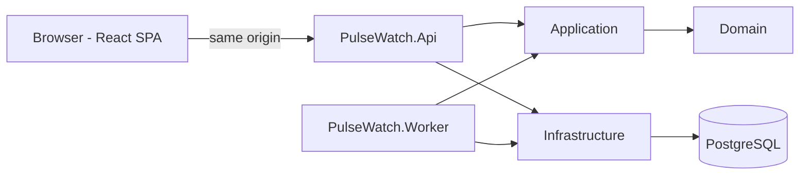

# PulseWatch

**Know when your APIs fail — and understand why.**

PulseWatch is an open-source, self-hostable tool that checks your HTTP APIs on a schedule, records status and response time, opens an incident when failures persist, emails you when it starts and when it recovers, and shows the history in a dashboard.

> **Status: Milestone 1 (domain and database).** The domain model, incident state machine and PostgreSQL schema are in place and tested. Sign-in, the monitor API, the probe engine, alerts and the real dashboard are **not built yet**. See [IMPLEMENTATION_PLAN.md](IMPLEMENTATION_PLAN.md) for the full roadmap and [docs/progress.md](docs/progress.md) for what each milestone delivered.

## What works today

| Area | State |
|---|---|
| .NET solution (Domain, Application, Infrastructure, Api, Worker + tests) | ✅ builds, dependency rules enforced by tests |
| Domain model: monitors, checks, incidents, notification outbox | ✅ with the incident state machine (failure/recovery thresholds) unit-tested |
| PostgreSQL schema via EF Core migrations | ✅ CHECK constraints, cascades, one-open-incident-per-monitor unique index |
| API `/health/live` and `/health/ready` | ✅ readiness checks the database is reachable and fully migrated |
| Worker host | ✅ starts, logs a heartbeat, shuts down cleanly |
| PostgreSQL + Mailpit via Docker Compose | ✅ |
| React frontend shell | ✅ shows whether the API is reachable |
| CI (format, build, test for .NET and React) | ✅ workflow defined |
| Sign-in, monitor API, probing, alerts, dashboard | ⏳ Milestones 2–6 |

## Architecture

A modular monolith with two executables sharing class libraries:



| Project | Responsibility | May reference |
|---|---|---|
| `src/PulseWatch.Domain` | Entities and business rules | nothing |
| `src/PulseWatch.Application` | Use cases, DTOs, interfaces | Domain |
| `src/PulseWatch.Infrastructure` | EF Core, HTTP probing, email | Application, Domain |
| `src/PulseWatch.Api` | HTTP endpoints, auth, health | Application, Infrastructure |
| `src/PulseWatch.Worker` | Scheduled checks, alerts, retention | Application, Infrastructure |
| `web/` | React + TypeScript + Vite SPA | the HTTP API only |

## Prerequisites

| Tool | Version used | Check |
|---|---|---|
| .NET SDK | 10.0.400 or a later 10.0 feature band (pinned in `global.json`) | `dotnet --list-sdks` |
| Node.js | 22 or later (24 LTS used in development) | `node --version` |
| Docker Desktop | any recent version, running | `docker info` |
| Git | any recent version | `git --version` |

## Getting started

### 1. Start the database and test mail server

```powershell
Copy-Item .env.example .env    # then edit .env and set POSTGRES_PASSWORD
docker compose up -d
docker compose ps              # db and mailpit should show "healthy"
```

macOS/Linux: `cp .env.example .env`.

- PostgreSQL: `localhost:5432` (bound to 127.0.0.1 only)
- Mailpit inbox: <http://localhost:8025>

### 2. Store the connection string and create the schema

Use the same password you put in `.env`:

```powershell
dotnet user-secrets set "ConnectionStrings:PulseWatch" "Host=localhost;Port=5432;Database=pulsewatch;Username=pulsewatch;Password=<your password>" --project src/PulseWatch.Api
dotnet user-secrets set "ConnectionStrings:PulseWatch" "Host=localhost;Port=5432;Database=pulsewatch;Username=pulsewatch;Password=<your password>" --project src/PulseWatch.Worker
dotnet run --project src/PulseWatch.Api -- --migrate
```

`--migrate` applies pending migrations and exits. It only works in Development; see [Database migrations](#database-migrations) for other environments.

### 3. Run the API and worker

In two terminals:

```powershell
dotnet run --project src/PulseWatch.Api       # http://localhost:5080
dotnet run --project src/PulseWatch.Worker
```

Check the API: <http://localhost:5080/health/live> and <http://localhost:5080/health/ready> should both return `Healthy`. Ready returns `Unhealthy` (HTTP 503) if the database is down or migrations are pending. The OpenAPI document is at <http://localhost:5080/openapi/v1.json> (Development only).

### 4. Run the frontend

```powershell
cd web
npm install
npm run dev                                    # http://localhost:5173
```

The Vite dev server forwards `/api` and `/health` to the API on port 5080, so the browser sees one origin. Set `PULSEWATCH_API_URL` to point it elsewhere.

## Database migrations

Migrations live in `src/PulseWatch.Infrastructure/Persistence/Migrations`. The EF Core CLI is a local tool:

```powershell
dotnet tool restore
dotnet ef migrations add <Name> --project src/PulseWatch.Infrastructure --startup-project src/PulseWatch.Api --output-dir Persistence/Migrations
dotnet ef migrations script --project src/PulseWatch.Infrastructure --startup-project src/PulseWatch.Api   # review the SQL
```

Applying migrations:

- **Development:** `dotnet run --project src/PulseWatch.Api -- --migrate`
- **Other environments:** build a migration bundle and run it as a separate deployment step, before starting the new version. The app never migrates automatically on startup.

  ```powershell
  dotnet ef migrations bundle --project src/PulseWatch.Infrastructure --startup-project src/PulseWatch.Api -o efbundle.exe
  ./efbundle.exe --connection "<connection string>"
  ```

## Running checks

Backend (from the repository root):

```powershell
dotnet format PulseWatch.slnx --verify-no-changes
dotnet build PulseWatch.slnx
dotnet test
```

`dotnet test` uses Microsoft.Testing.Platform (configured in `global.json`), which .NET 10 requires for xUnit v3.

The integration tests need **Docker running**: they start a throwaway PostgreSQL 18 container (Testcontainers) and give each test its own empty database. They never touch your Compose database.

Frontend (from `web/`):

```powershell
npm run format:check
npm run lint          # oxlint
npm run typecheck
npm test              # Vitest + Testing Library
npm run build
```

CI runs the same commands on every push and pull request (`.github/workflows/ci.yml`).

## Configuration and secrets

- Never commit real credentials. `.env` is git-ignored; `.env.example` holds placeholders only.
- For `dotnet run`, keep the connection string in user-secrets (see Getting started, step 2). In containers or servers, use the `ConnectionStrings__PulseWatch` environment variable.
- If the connection string is missing, the API stops at startup with a message saying how to set it.
- Monitoring settings (section `Monitoring`) are validated at startup. They can only narrow the hard limits in `MonitorLimits` (e.g. interval 60–3600 s), which the database also enforces.

- The full list of settings is in [IMPLEMENTATION_PLAN.md §8](IMPLEMENTATION_PLAN.md#8-configuration).

## Version decisions

- **.NET 10 LTS**, SDK pinned to the 10.0.400 band with `rollForward: latestFeature`.
- **Microsoft.\* packages pinned to 10.0.11** to match the installed ASP.NET Core runtime. Dependabot groups patch updates for these.
- Package versions live in one place: `Directory.Packages.props` (central package management).
- **EF Core 10.0.11** with **Npgsql.EntityFrameworkCore.PostgreSQL 10.0.3** and snake_case naming (EFCore.NamingConventions).
- **xUnit v3** with Microsoft.Testing.Platform; **Testcontainers 4.16** for database tests.
- **PostgreSQL 18.6** (Alpine image) and **Mailpit 1.33.1** in Docker Compose.
- Frontend: **React 19, Vite 8, TypeScript 7, Tailwind CSS 4, React Router 8, Vitest 5**. Linting uses **oxlint**, which the current Vite template ships with, instead of ESLint.

## Known limitations

Nothing is monitored yet: there is no sign-in, no monitor API and no probe engine. Do not deploy it publicly.

## License

[MIT](LICENSE)
