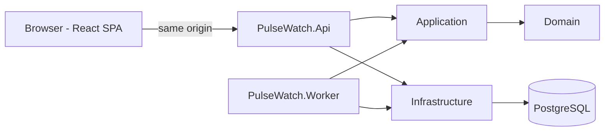

# PulseWatch

**Know when your APIs fail — and understand why.**

PulseWatch is an open-source, self-hostable tool that checks your HTTP APIs on a schedule, records status and response time, opens an incident when failures persist, emails you when it starts and when it recovers, and shows the history in a dashboard.

> **Status: Milestone 5 (email alerts).** The worker checks your monitors on schedule, opens an incident after repeated failures, resolves it on recovery, and emails the owner when an incident opens and when it recovers. Check history, incidents and email delivery status are available through the API. The real dashboard comes in Milestone 6. See [IMPLEMENTATION_PLAN.md](IMPLEMENTATION_PLAN.md) for the full roadmap and [docs/progress.md](docs/progress.md) for what each milestone delivered.

## What works today

| Area | State |
|---|---|
| .NET solution (Domain, Application, Infrastructure, Api, Worker + tests) | ✅ builds, dependency rules enforced by tests |
| Domain model: monitors, checks, incidents, notification outbox | ✅ with the incident state machine (failure/recovery thresholds) unit-tested |
| PostgreSQL schema via EF Core migrations | ✅ CHECK constraints, cascades, one-open-incident-per-monitor unique index |
| API `/health/live` and `/health/ready` | ✅ readiness checks the database is reachable and fully migrated |
| Accounts: register, sign in/out, `/me` | ✅ ASP.NET Core Identity, HttpOnly SameSite=Strict cookie, anti-forgery header, lockout, rate limits |
| Monitor API: list, create, get, edit, pause, resume, check-now, delete | ✅ every query scoped to the signed-in user; quota; optimistic concurrency (ETag / If-Match) |
| URL safety (SSRF layers 1–2) | ✅ http/https only, no credentials, allowed ports, local host names blocked, every DNS answer must be public |
| Worker: scheduled checks | ✅ leases due monitors (`FOR UPDATE SKIP LOCKED`), probes with bounded concurrency, records one result per attempt, updates health, opens incidents, writes a heartbeat |
| Probe engine | ✅ one GET per check (no retries), overall timeout, capped body read, manual redirects re-validated each hop, categorised outcomes |
| SSRF layer 3 (connect-time check) | ✅ the probe resolves and checks the host itself and connects only to the address it checked, which blocks DNS rebinding |
| PostgreSQL + Mailpit via Docker Compose | ✅ |
| React frontend shell | ✅ shows whether the API is reachable |
| CI (format, build, test for .NET and React) | ✅ workflow defined |
| Check history and incidents API | ✅ per-monitor check history (time window, paged), per-monitor and global incident lists, incident details with notification history |
| Email alerts | ✅ one email when an incident opens and one when it recovers, written to an outbox in the same transaction as the incident; retries with backoff; delivery status on the incident |
| Dashboard | ⏳ Milestone 6 |

## Architecture

A modular monolith with two executables sharing class libraries:



| Project | Responsibility | May reference |
|---|---|---|
| `src/PulseWatch.Domain` | Entities and business rules | nothing |
| `src/PulseWatch.Application` | Use cases, DTOs, interfaces | Domain |
| `src/PulseWatch.Infrastructure` | EF Core, HTTP probing, email | Application, Domain |
| `src/PulseWatch.Api` | HTTP endpoints, auth, health | Application, Infrastructure |
| `src/PulseWatch.Worker` | Scheduled checks, alerts, retention | Application, Infrastructure |
| `web/` | React + TypeScript + Vite SPA | the HTTP API only |

## Prerequisites

| Tool | Version used | Check |
|---|---|---|
| .NET SDK | 10.0.400 or a later 10.0 feature band (pinned in `global.json`) | `dotnet --list-sdks` |
| Node.js | 22 or later (24 LTS used in development) | `node --version` |
| Docker Desktop | any recent version, running | `docker info` |
| Git | any recent version | `git --version` |

## Getting started

### 1. Start the database and test mail server

```powershell
Copy-Item .env.example .env    # then edit .env and set POSTGRES_PASSWORD
docker compose up -d
docker compose ps              # db and mailpit should show "healthy"
```

macOS/Linux: `cp .env.example .env`.

- PostgreSQL: `localhost:5432` (bound to 127.0.0.1 only)
- Mailpit inbox: <http://localhost:8025>

### 2. Store the connection string and create the schema

Use the same password you put in `.env`:

```powershell
dotnet user-secrets set "ConnectionStrings:PulseWatch" "Host=localhost;Port=5432;Database=pulsewatch;Username=pulsewatch;Password=<your password>" --project src/PulseWatch.Api
dotnet user-secrets set "ConnectionStrings:PulseWatch" "Host=localhost;Port=5432;Database=pulsewatch;Username=pulsewatch;Password=<your password>" --project src/PulseWatch.Worker
dotnet run --project src/PulseWatch.Api -- --migrate
```

`--migrate` applies pending migrations and exits. It only works in Development; see [Database migrations](#database-migrations) for other environments.

### 3. Run the API and worker

In two terminals:

```powershell
dotnet run --project src/PulseWatch.Api       # http://localhost:5080
dotnet run --project src/PulseWatch.Worker
```

Check the API: <http://localhost:5080/health/live> and <http://localhost:5080/health/ready> should both return `Healthy`. Ready returns `Unhealthy` (HTTP 503) if the database is down or migrations are pending.

API reference (Development only): interactive docs at <http://localhost:5080/scalar>, OpenAPI JSON at <http://localhost:5080/openapi/v1.json>.

### 4. Run the frontend

```powershell
cd web
npm install
npm run dev                                    # http://localhost:5173
```

The Vite dev server forwards `/api` and `/health` to the API on port 5080, so the browser sees one origin. Set `PULSEWATCH_API_URL` to point it elsewhere.

## Using the API

All endpoints are under `/api/v1`. Errors use [Problem Details](https://www.rfc-editor.org/rfc/rfc9457); validation errors list the failing fields.

1. `GET /api/v1/auth/antiforgery` sets an `XSRF-TOKEN` cookie.
2. Send that cookie's value in the `X-XSRF-TOKEN` header on **every** POST, PATCH and DELETE. A fresh token is issued after sign-in and sign-out.
3. `POST /api/v1/auth/register` or `/login` with `{ "email": "...", "password": "..." }` sets the HttpOnly `pw.auth` cookie. Passwords need at least 12 characters.
4. Manage monitors: `GET/POST /api/v1/monitors`, `GET/PATCH/DELETE /api/v1/monitors/{id}`, `POST .../pause`, `.../resume`, `.../check-now`.
5. Read results:
   - `GET /api/v1/monitors/{id}/checks?fromUtc=&toUtc=&page=&pageSize=` — newest first; defaults to the last 24 hours; a window can span at most the retention period (30 days).
   - `GET /api/v1/monitors/{id}/incidents` — this monitor's incidents, newest first.
   - `GET /api/v1/incidents?status=open|resolved` — all your incidents.
   - `GET /api/v1/incidents/{id}` — one incident with its notification history.

   Incident durations run from the **first failed check** to recovery (or to now while open). Detection is delayed by the failure threshold: with a 60 s interval and a threshold of 3, an incident opens about 2–3 minutes after the first failure.

Rules worth knowing:
- Another user's monitor or incident id returns the same `404` as an id that doesn't exist.
- Monitor URLs must point to a public destination. Local names (`localhost`, `*.local`, `*.internal`, …), private/reserved IPs and host names whose DNS answers include any non-public address are rejected.
- `PATCH` changes only the fields you send. Send `If-Match: <ETag>` to get `412` instead of overwriting a newer change.
- `check-now` returns `202` and is limited to once per minute per monitor (`429` with `Retry-After`). The worker runs the check on its next poll (within about 5 seconds).

## How checks work

The worker (`src/PulseWatch.Worker`) polls every `Monitoring:PollIntervalSeconds` (5 s):

1. It **leases** up to `BatchSize` (50) enabled monitors that are due, in one SQL statement (`FOR UPDATE SKIP LOCKED`). A leased monitor can't be picked up by another worker until its result is recorded or the lease expires (probe timeout + 30 s), so a crashed worker never leaves a monitor stuck.
2. It **probes** them, at most `MaxConcurrentChecks` (10) at a time. Each probe is one `GET` with the monitor's timeout covering everything, no cookies or credentials, at most `MaxRedirects` (3) redirects (each re-validated), and at most `MaxResponseBytes` (64 KB) of body read.
3. It **records** each result in one transaction: the check row, the monitor's state and counters, an incident if the failure threshold is reached (or its resolution), the alert email for that incident event (an outbox row), and the next check time (one interval after this check started).

Outcomes: `Success`, `HttpStatusFailure`, `Timeout`, `DnsFailure`, `TlsFailure`, `ConnectionFailure`, `RedirectRejected`, `DestinationBlocked`, `UnexpectedError`. Stored error summaries are fixed text, never exception messages or response content.

Scheduling tolerance: a check runs within about one poll interval of its due time, plus queueing when more than `MaxConcurrentChecks` monitors are due together. A failed or slow monitor never blocks the others. On shutdown the worker stops claiming and lets in-flight checks finish (up to 30 s).

Results describe what the worker saw from **its** network location, not what every user everywhere sees.

## How email alerts work

The monitor's owner gets **one email when an incident opens** and **one when it recovers**. Nothing is sent for the failures in between.

- **No lost alerts.** The email is queued in the `notification_outbox` table in the same transaction that opens or resolves the incident, so a committed incident always has its email queued. A unique key (incident, event, channel, recipient) prevents duplicates.
- **Delivery.** The worker's outbox dispatcher polls every `Notifications:PollIntervalSeconds` (10 s), leases up to 20 due messages (`FOR UPDATE SKIP LOCKED`) and sends them.
- **Retries.** A failed send is retried after about 30 s, 1, 2, 4 and 8 minutes (doubling, ±20 % jitter, at most 1 hour). After `Notifications:MaxAttempts` (6) attempts, or straight away for a rejected address, the message is marked **Exhausted**.
- **Visible status.** `GET /api/v1/incidents/{id}` lists each email with its status (`Pending`, `Sending`, `Sent`, `Failed`, `Exhausted`), attempt count and an error category such as `ConnectionFailed` or `AuthenticationFailed`. Server replies and exception messages are never stored.
- **Independent of checks.** A mail outage never delays or breaks check recording.
- **Safe content.** Emails show the monitor name, the endpoint **without its query string** (query strings often hold API keys), what failed, UTC times and a link to the incident. Names are HTML-encoded, and line breaks are removed from the subject so they can't add mail headers.

Delivery is **at least once**: if the worker stops after the mail server accepted an email but before it was marked Sent, that email is sent again after the lease expires.

**Providers** (`Notifications:Provider`):

- `Logging` (the default) writes each email to the worker log instead of sending it.
- `Smtp` sends through the server in the `Email` section. To try it locally with Mailpit:

  ```powershell
  dotnet user-secrets set "Notifications:Provider" "Smtp" --project src/PulseWatch.Worker
  dotnet user-secrets set "Email:Host" "localhost" --project src/PulseWatch.Worker
  dotnet user-secrets set "Email:Port" "1025" --project src/PulseWatch.Worker
  dotnet user-secrets set "Email:UseStartTls" "false" --project src/PulseWatch.Worker
  dotnet user-secrets set "Email:FromAddress" "alerts@pulsewatch.localhost" --project src/PulseWatch.Worker
  ```

  Then open the inbox at <http://localhost:8025>. For a real provider, keep `UseStartTls` at `true` (the default) or use port 465, and put `Email:Username` and `Email:Password` in user-secrets or environment variables. PulseWatch never logs them.

Links in emails point at `App:PublicBaseUrl` (default `http://localhost:5173`).

## Database migrations

Migrations live in `src/PulseWatch.Infrastructure/Persistence/Migrations`. The EF Core CLI is a local tool:

```powershell
dotnet tool restore
dotnet ef migrations add <Name> --project src/PulseWatch.Infrastructure --startup-project src/PulseWatch.Api --output-dir Persistence/Migrations
dotnet ef migrations script --project src/PulseWatch.Infrastructure --startup-project src/PulseWatch.Api   # review the SQL
```

Applying migrations:

- **Development:** `dotnet run --project src/PulseWatch.Api -- --migrate`
- **Other environments:** build a migration bundle and run it as a separate deployment step, before starting the new version. The app never migrates automatically on startup.

  ```powershell
  dotnet ef migrations bundle --project src/PulseWatch.Infrastructure --startup-project src/PulseWatch.Api -o efbundle.exe
  ./efbundle.exe --connection "<connection string>"
  ```

## Running checks

Backend (from the repository root):

```powershell
dotnet format PulseWatch.slnx --verify-no-changes
dotnet build PulseWatch.slnx
dotnet test
```

`dotnet test` uses Microsoft.Testing.Platform (configured in `global.json`), which .NET 10 requires for xUnit v3.

The integration tests need **Docker running**: they start a throwaway PostgreSQL 18 container (Testcontainers) and give each test its own empty database. They never touch your Compose database.

Frontend (from `web/`):

```powershell
npm run format:check
npm run lint          # oxlint
npm run typecheck
npm test              # Vitest + Testing Library
npm run build
```

CI runs the same commands on every push and pull request (`.github/workflows/ci.yml`).

## Configuration and secrets

- Never commit real credentials. `.env` is git-ignored; `.env.example` holds placeholders only.
- For `dotnet run`, keep the connection string in user-secrets (see Getting started, step 2). In containers or servers, use the `ConnectionStrings__PulseWatch` environment variable.
- If the connection string is missing, the API stops at startup with a message saying how to set it.
- Rate limits (section `RateLimiting`, per minute): `AuthPermitsPerMinute` 10 per IP, `WritePermitsPerMinute` 30 per user, `CheckNowPermitsPerMinute` 10 per user.
- Notification settings (sections `Notifications`, `Email`, `App`) are validated when the worker starts. With `Provider` set to `Smtp`, `Email:Host` and `Email:FromAddress` are required.
- Monitoring settings (section `Monitoring`) are validated at startup. They can only narrow the hard limits in `MonitorLimits` (e.g. interval 60–3600 s), which the database also enforces.

- The full list of settings is in [IMPLEMENTATION_PLAN.md §8](IMPLEMENTATION_PLAN.md#8-configuration).

## Version decisions

- **.NET 10 LTS**, SDK pinned to the 10.0.400 band with `rollForward: latestFeature`.
- **Microsoft.\* packages pinned to 10.0.11** to match the installed ASP.NET Core runtime. Dependabot groups patch updates for these.
- Package versions live in one place: `Directory.Packages.props` (central package management).
- **EF Core 10.0.11** with **Npgsql.EntityFrameworkCore.PostgreSQL 10.0.3** and snake_case naming (EFCore.NamingConventions).
- **xUnit v3** with Microsoft.Testing.Platform; **Testcontainers 4.16** for database tests.
- **Scalar.AspNetCore 2.18.7** for the Development API reference page.
- **MailKit 4.18.2** for SMTP.
- **PostgreSQL 18.6** (Alpine image) and **Mailpit 1.33.1** in Docker Compose.
- Frontend: **React 19, Vite 8, TypeScript 7, Tailwind CSS 4, React Router 8, Vitest 5**. Linting uses **oxlint**, which the current Vite template ships with, instead of ESLint.

## Known limitations

- Do not deploy publicly until the release checklist in Milestone 8 passes. In particular, the outbound firewall for the worker (SSRF layer 4) is a deployment step that isn't done yet.
- Several workers can run safely (claiming is tested with 8 concurrent claimers), but run **one worker** until you have tested multiple replicas in your own deployment.
- If an edit to a monitor lands at the exact moment the worker claims or records it, the edit gets `412` ("changed by another request") and must be retried.
- Alert emails are delivered at least once: in rare crash timing an email can arrive twice (see [How email alerts work](#how-email-alerts-work)). Alerts go only to the monitor's owner.
- Registration reveals whether an email is already registered (there is no email confirmation). The per-IP auth rate limit slows bulk checking.
- Rate limits use the client IP; behind a reverse proxy, forwarded headers must be configured first (Milestone 8).
- Data-protection keys (which sign the auth cookie) use the ASP.NET Core default store; in containers they must be persisted or users are signed out on restart (Milestone 8).

## License

[MIT](LICENSE)
